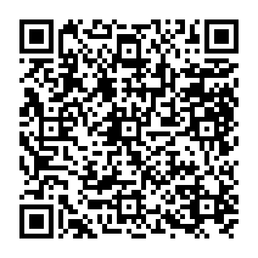

# SHIELD Theme Music Extractor
**Codex was used to develop this tool.**

Offline 3DS app to find, preview and copy the `BGM.ogg` audio from Anemone themes. It scans `sdmc:/themes/`, including ZIP archives, without unpacking whole archives.

**Dernière release : [v1.0.5](https://github.com/Shield-77/Shield-Theme-Music-Extractor/releases/tag/v1.0.5).** Elle améliore la lisibilité et propose français ou anglais avec un guide de démarrage. La lisibilité a été validée par Shield-77 sur console.

## Features

- Lists each music file by its theme name and source type (ZIP or folder).
- Previews OGG Vorbis audio before copying; OGG playback is confirmed working on the project owner's 3DS.
- Copies only the selected `BGM.ogg`. The default output filename is the theme name plus `.ogg` to prevent collisions; you can choose `BGM.ogg` instead.
- Prompts before overwriting an existing file.
- Lets you choose the destination folder and lists folders containing MP3 files first.
- Works fully offline and does not modify the original theme.

## Controls

- Theme list: Up/Down selects, Y previews or stops, A starts the copy flow, X rescans, B stops preview.
- Destination picker: Up/Down selects, A opens a folder, X selects the current folder, B goes up/returns.
- Filename: A saves as `<theme name>.ogg`; X keeps `BGM.ogg`. Existing files require confirmation.
- First launch shows a 3-page guide. Hold SELECT at startup to view it again.

## Télécharger / Download

**[ShieldThemeMusicExtractor.cia (v1.0.5)](https://github.com/Shield-77/Shield-Theme-Music-Extractor/releases/download/v1.0.5/ShieldThemeMusicExtractor.cia)** · [Toutes les releases](https://github.com/Shield-77/Shield-Theme-Music-Extractor/releases)

Sur une 3DS modifiée, ouvrir FBI > Remote Install > Scan QR Code.

## Informations sur la version

[Télécharger ShieldThemeMusicExtractor.cia v1.0.5](https://github.com/Shield-77/Shield-Theme-Music-Extractor/releases/download/v1.0.5/ShieldThemeMusicExtractor.cia)

## Build and license

The **v1.0.5 source** is available in [`source/`](source/) with the Makefile, artwork, font and third-party notices in this repository. Build with devkitPro and the dependencies listed in [README-SOURCE.md](README-SOURCE.md). Application code and original artwork are under [MIT](LICENSE); libraries and the font keep their own licenses in [THIRD_PARTY_NOTICES.md](THIRD_PARTY_NOTICES.md) and [`licenses/`](licenses/).

Please respect copyright and audio licensing. I designed this tool simply to allow for listening—on the 3DS—to the music found in many themes; these tracks often have great tunes but are frequently impossible to track down, even using Shazam (I mean, how could Shazam possibly analyze songs sung by Inklings? ). Anyway, the goal is to provide the simplest way possible to listen to the background music from your favorite themes—and perhaps even enjoy them via Shield DJ? nah listen theme anywhere in OGG format !

(Shield is not affiliated with ameone, this does not change your themes, you do not trust the project generated with codex? The source code is there precisely so you can examine it, or even create your own version. Bugs are still possible; Codex isn't perfect).

## Développement

Le code a été généré avec l'aide d'OpenAI Codex, un assistant de programmation par IA. SHIELD-77 conçoit les fonctionnalités et teste les applications sur console lorsque possible.
